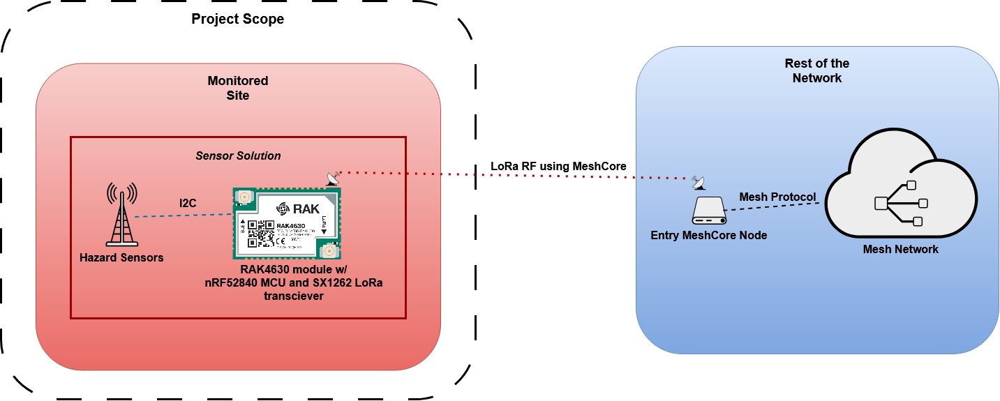

# hazard-sensor-network-firmware
Working repository for firmware development of the Local Hazard Network project for ANU Capstone 2026.

For more details on the project visit: https://localhazardnetwork.netlify.app/

This repository contains firmware code for the sensor node. Firmware is written for the RAK4630 module (attached to the RAK19007 baseboard), which houses a Nordic nRF52840 MCU and a Semtech SX1262 LoRa® transceiver. Interfacing with the RAK4630 are various sensor hardware and a watchdog module.

The sensor hardware are various commercial off-the-shelf sensors that can collect various environmental data that is packaged up and sent to an external receiver using MeshCore. Sensors include: BME680 Gas Sensor (measures air quality, temperature, humidity, and pressure), SEN0575 Tipping Bucket Sensor (measures rainfall), SEN0193 Soil Moisture (measures soil moisture), and EF04083 Cup Anemometer (measures wind speed). The SEN0193 and EF04083 interfaces with the RAK module using I2C via the ADS1115 ADC to I2C, while the BME680 and SEN0575 interfaces with the RAK module directly over the same I2C bus.

The MIKROE-4416 watchdog module interfaces with the RESET line of the RAK module and periodically receive heartbeats from the RAK module over GPIO. If the watchdog fails to receive a heartbeat from the RAK module (program crash/freezes), the watchdog automatically pulls the RESET line to reset the RAK module in hope of fixing the error.

There are two separate binaries:
`hazard-sensor` contains the firmware for the RAK4630 module and drivers for the sensor hardware and watchdog module.
`demo` contains the binary for running a meshcore client to talk to the sensor node and gather data. The data is uploaded to an InfluxDB container so that it can be processed externally.
