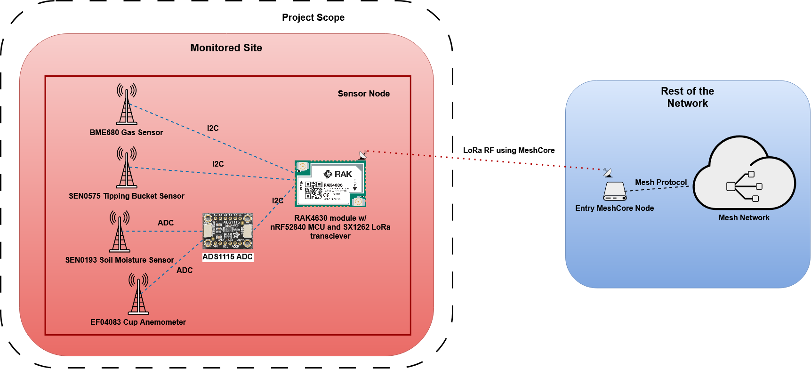

# Hazard Sensor Network Firmware

Firmware for the sensor node of the **Local Hazard Network** project (ANU Capstone 2026).

For more details on the project, visit the [project website](https://localhazardnetwork.netlify.app/).



## Overview

The firmware targets the **RAK4630** module mounted on a **RAK19007** baseboard. The RAK4630 houses a Nordic **nRF52840** MCU and a Semtech **SX1262** LoRa® transceiver. Environmental data is collected from commercial off-the-shelf sensors, packaged up, and sent to an external receiver using [MeshCore](https://github.com/meshcore-dev/MeshCore).

## Hardware

### Sensors

| Sensor | Measures | Interface |
|--------|----------|-----------|
| BME680 | Air quality (gas), temperature, humidity, pressure | I2C (direct) |
| SEN0575 Tipping Bucket | Rainfall | I2C (direct) |
| SEN0193 | Soil moisture | ADS1115 ADC → I2C |
| EF04083 Cup Anemometer | Wind speed | ADS1115 ADC → I2C |

The BME680 and SEN0575 share the same I2C bus as the ADS1115.

### Watchdog

The **MIKROE-4416** watchdog module is connected to the RAK module's `RESET` line and receives periodic heartbeats from the RAK module over GPIO. If a heartbeat is not received (e.g. the program crashes or freezes), the watchdog pulls `RESET` to restart the RAK module.

## Repository Structure

```
hazard-sensor-network/
├── hazard-sensor/   # Rust (Cargo) project: RAK4630 firmware, sensor and watchdog drivers
└── demo/            # Python MeshCore client that logs sensor data to InfluxDB
```

| Binary | Description |
|--------|-------------|
| `hazard-sensor` | Firmware for the RAK4630 module, including drivers for the sensor hardware and the watchdog module. |
| `demo` | A MeshCore client that communicates with the sensor node and collects data for demonstration purposes. Data is uploaded to an InfluxDB container for external processing. |

## Building and Flashing the Firmware

### Prerequisites

- [Rust toolchain](https://rustup.rs/) with the `thumbv7em-none-eabi` target:
```sh
  rustup target add thumbv7em-none-eabi
```
- [probe-rs](https://probe.rs/docs/getting-started/installation/) for flashing and debug logging
- An **SWD debugger** (e.g. J-Link, ST-Link, or CMSIS-DAP probe) connected to the SWD pins of the nRF52840

### Build and flash

With the debugger plugged in and connected to the RAK4630, run the following from the `hazard-sensor/` directory:

```sh
cd hazard-sensor
cargo run --release
```

This builds the firmware, flashes it to the nRF52840 using `probe-rs`, and streams `defmt` log output to your terminal.

### Configuration

Build settings are in `hazard-sensor/.cargo/config.toml`:

- **Target:** `thumbv7em-none-eabi` (set as the default, so no `--target` flag is needed)
- **Runner:** `probe-rs run --chip nRF52840_xxAA`
- **Log level:** `DEFMT_LOG = "debug"`. Change this (e.g. `info`, `warn`) to adjust log verbosity.

## Running the Demo

The demo connects to the sensor node over MeshCore and uploads received readings to InfluxDB.

```sh
cd demo
python meshcore_influxdb_logger.py
```

Ensure a MeshCore repeater node (such as the WisMesh Repeater Mini) is paired to the PC via Bluetooth before running the client.

The demo code is stable for Python version 3.13.2 and InfluxDB3 version 3.12.0.
